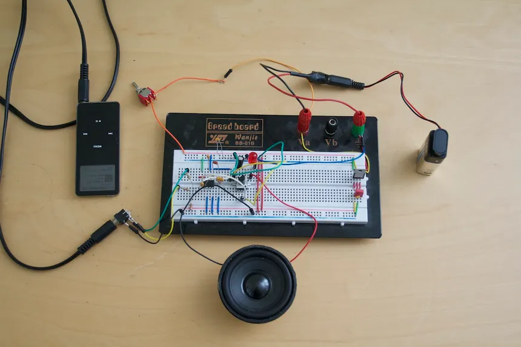

# LM386 Audio Amplifier

**A Third-Semester Electronics Engineering Project | MITS Gwalior**

## About the Project

This project focuses on the study and breadboard implementation of a low-voltage audio amplifier circuit using the LM386 integrated circuit.

The setup includes a breadboard circuit, an audio input connection, and a speaker output.

## Project Objectives

- Understand the basic working principle of audio amplification.
- Study the role of an audio amplifier IC in an electronic circuit.
- Learn practical circuit assembly and component connections.
- Document the circuit setup and testing process.

## Hardware Setup

The prototype is assembled on a breadboard and connected to an audio source and a speaker.

**Components, circuit values, power supply details, and pin connections will be added after verification.**

## Project Photograph

## Testing and Observations

Testing procedures and observations will be added after verifying the circuit configuration and measuring its performance.

## Future Improvements

- Add a verified circuit schematic.
- Document component values and connections.
- Record input/output observations and test results.
- Improve circuit documentation and troubleshooting notes.

## Author

**Vansh Kumar**  
B.Tech. Electronics Engineering  
Madhav Institute of Technology & Science (MITS), Gwalior
